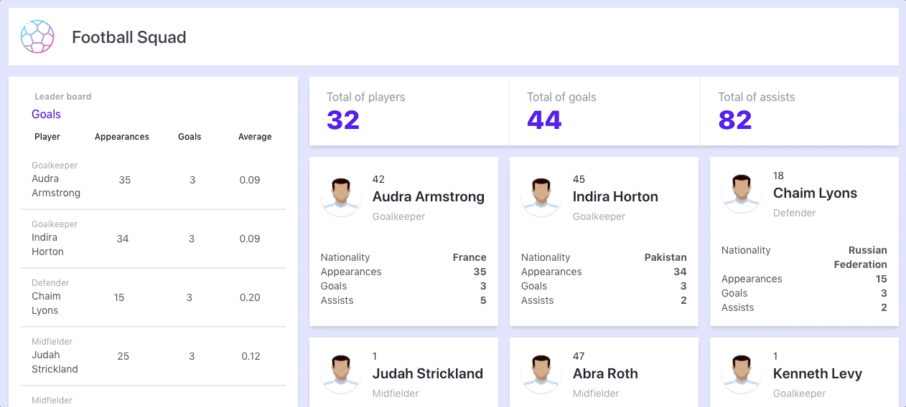
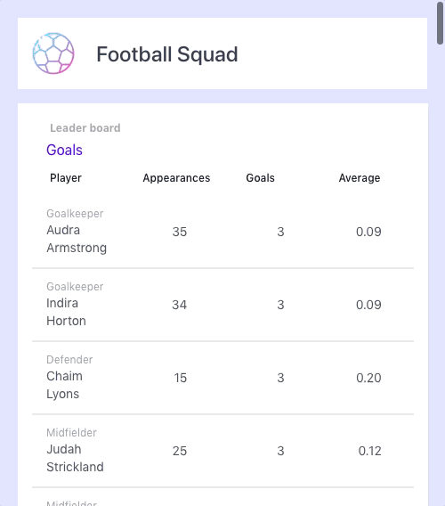

# Football squad stats

### Comments

This is a conceptual test aimed at trying out technologies such as:

- React (TypeScript).
- [Vite](https://vitejs.dev/)
- [Tailwindcss](https://tailwindcss.com/)
- [daisyUI](https://daisyui.com/)

The roster is demo data; the page shows a `Demo data` badge.

### Requirements

- Node.js 24 LTS (Vite supports `^20.19.0` or `>=22.12.0`)
- Yarn 1.22.22

### Installation and running the project

Clone the repository and install dependencies:

```shell
git clone https://github.com/christianjtr/football-squad.git
cd football-squad
yarn install
```

### Demo

#### Full width mode



#### Responsive mode



### Live Demo

Click on the following link (Github page project):

https://christianjtr.github.io/football-squad

### Commands

| Command | Purpose |
|---|---|
| `yarn dev` | Start the development server with hot reload |
| `yarn build` | Validate the roster, type-check, and build for production |
| `yarn serve` | Preview the production build |
| `yarn lint` | Type-check with `tsc` |
| `yarn validate` | Check roster IDs, shirt numbers, positions, stats, and totals |
| `yarn format` | Format source and config files with Prettier |

The production build uses relative asset paths (`base: './'`), so it works from the
GitHub Pages project URL.

### Technologies

React, TypeScript, Tailwindcss, daisyUI, Vite.
